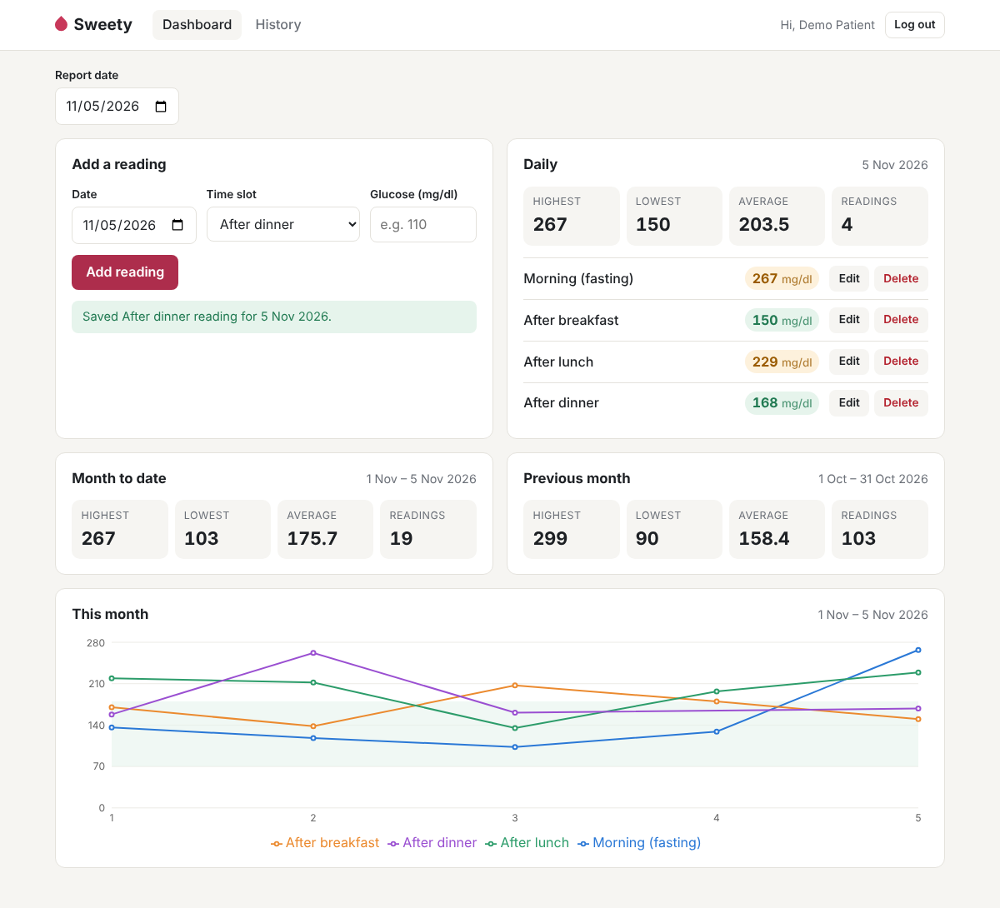
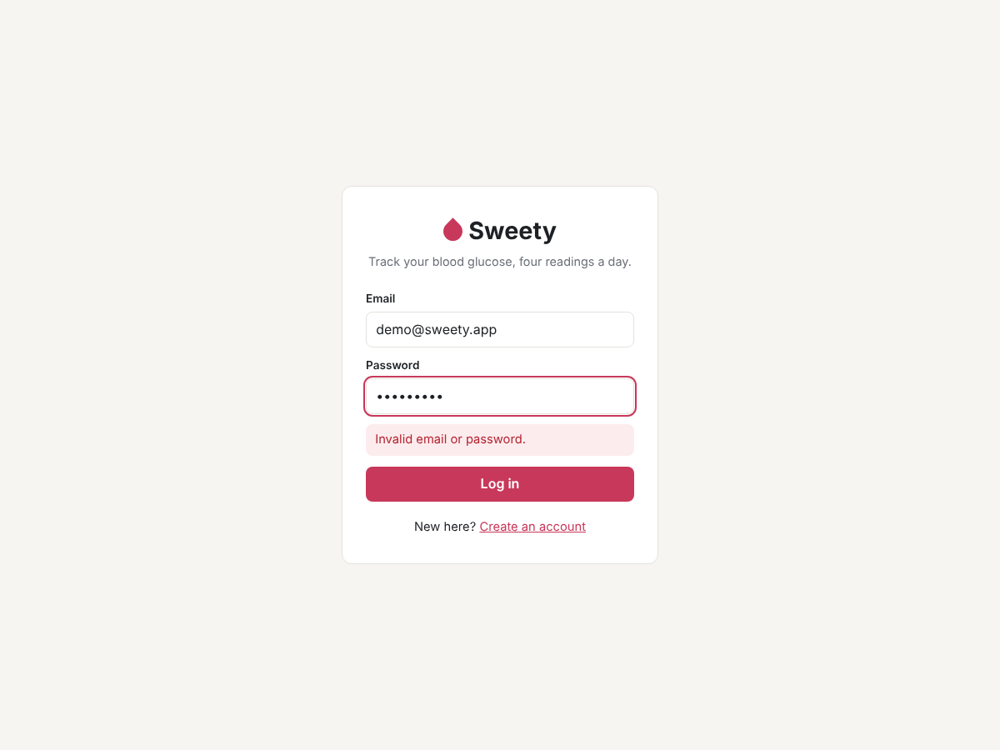
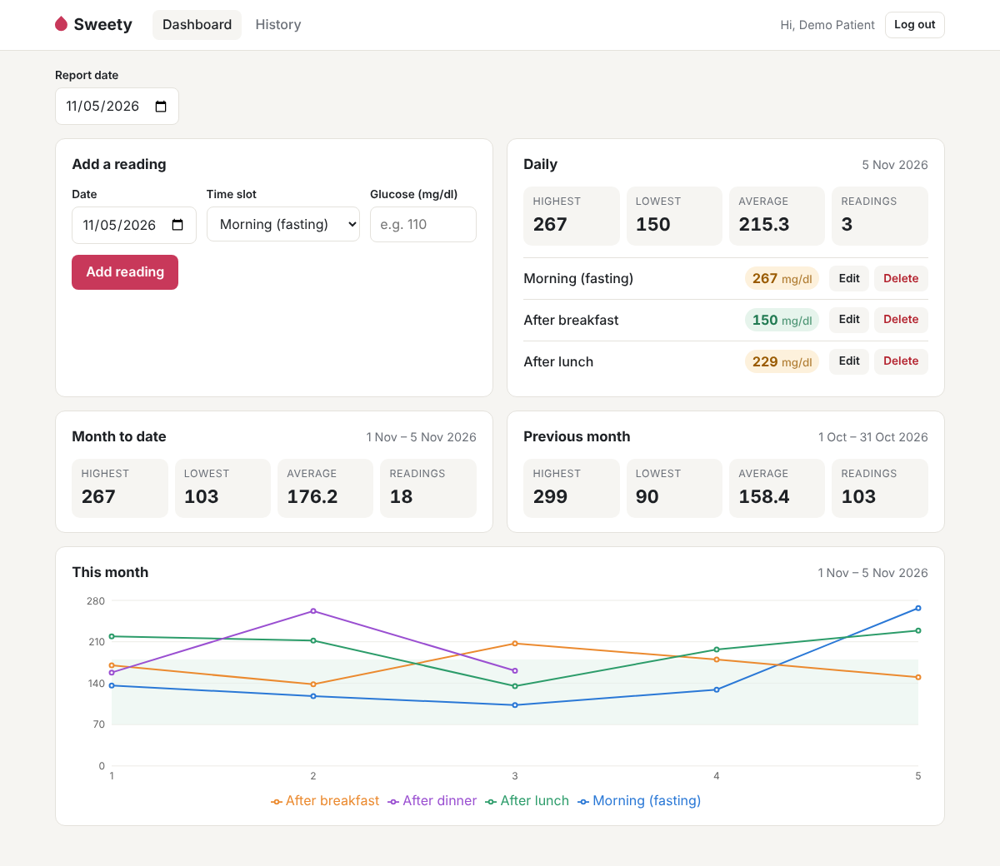
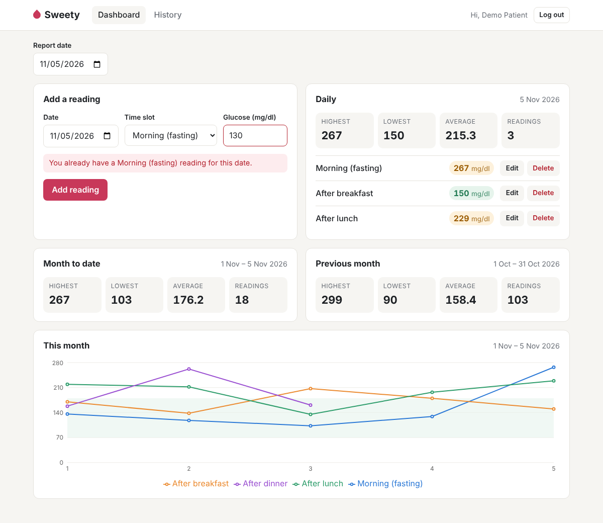
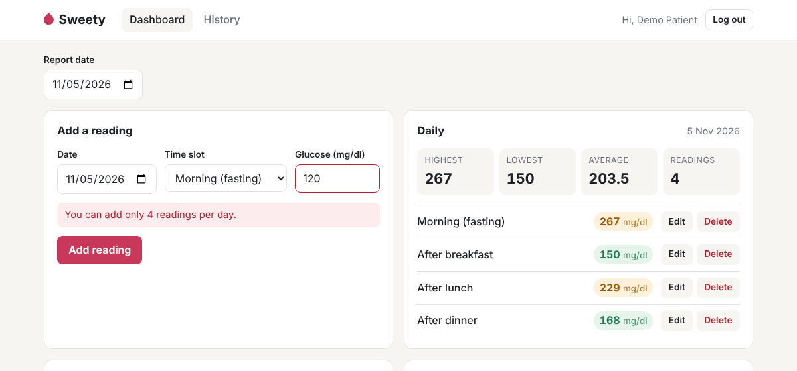
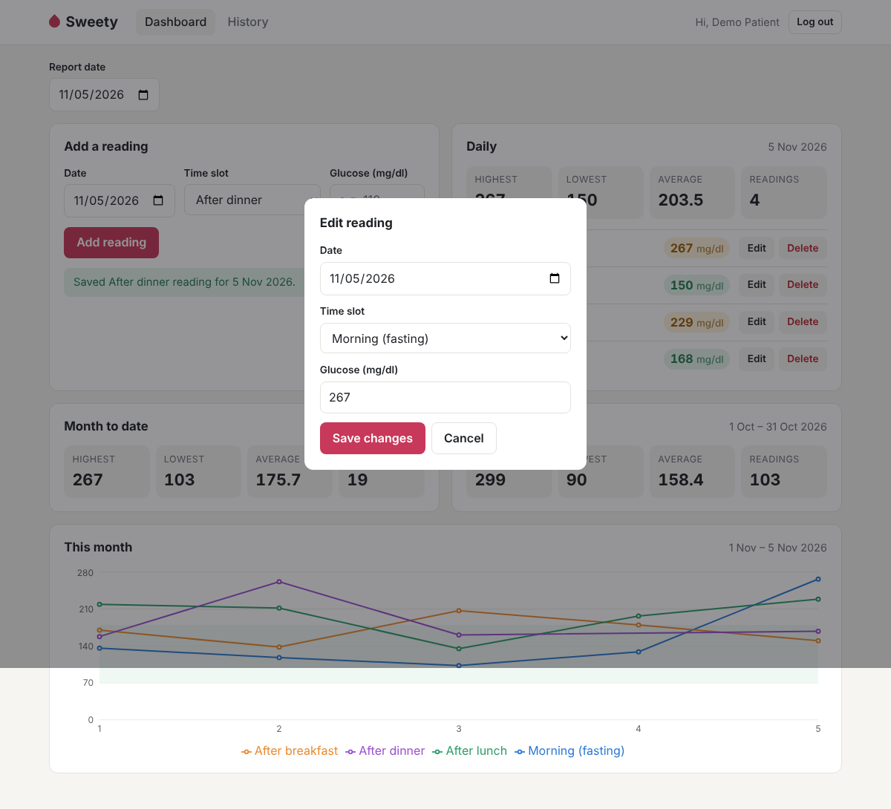
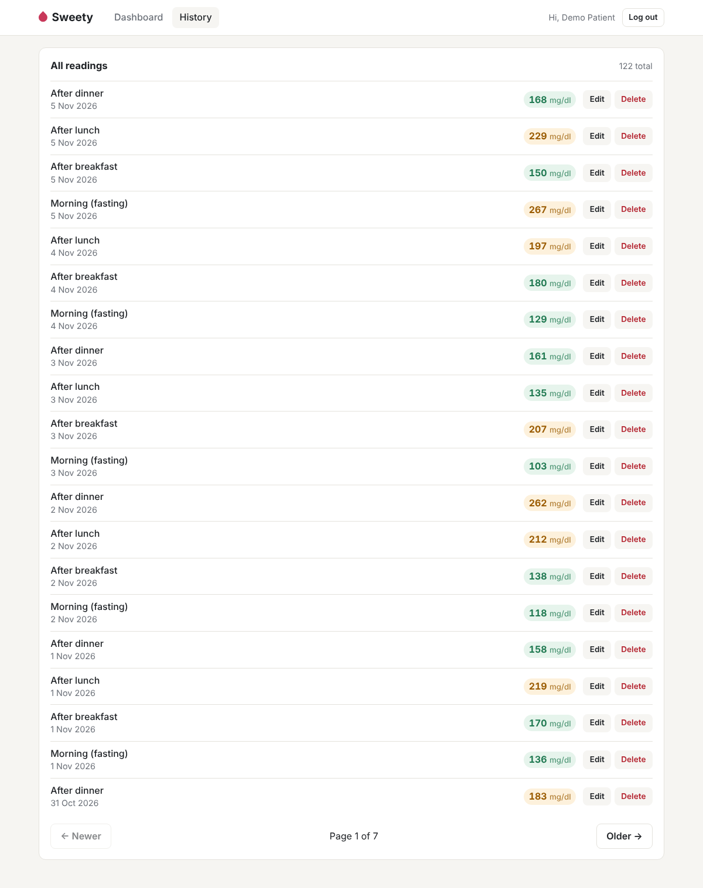
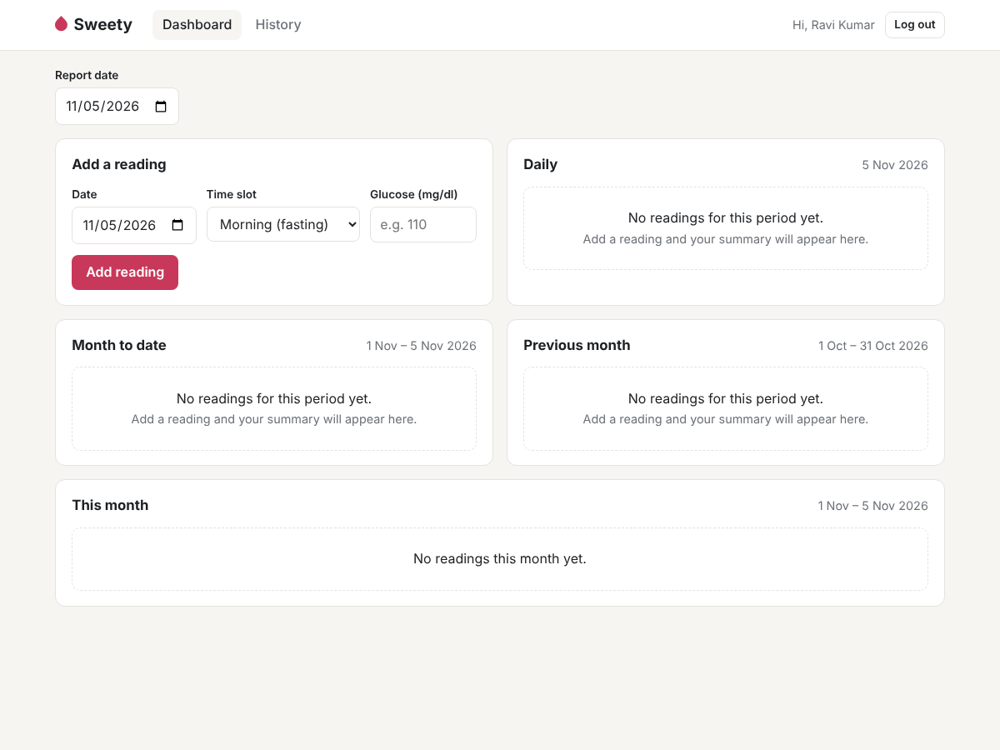

# Sweety – Blood Glucose Tracker

A small web app where a diabetes patient records up to 4 blood glucose readings a day
and views daily, month-to-date and monthly reports.

**Stack:** Node.js + Express 5 · PostgreSQL · React 19 (Vite) · Jest + Supertest · Vitest + React Testing Library · Recharts



## Features

**Required**
- Sign up / log in with name, email and password (passwords hashed with **bcrypt**, JWT for sessions)
- Every query is scoped to the logged-in user — users only ever see their own readings
- Add, view, edit and delete readings (date + slot + value in mg/dl)
- All five validation rules, enforced on the **server** and mirrored in the **UI** with the exact messages from the brief
- Daily, month-to-date and monthly (previous month) reports: highest, lowest, average (1 decimal), count, with a friendly empty state
- Daily report lists each reading with its slot

**Bonus tasks done**
- Pagination on `GET /api/readings?page=1&limit=20` (History page)
- Line chart of the month's readings per slot (Recharts)
- `docker-compose.yml` that starts PostgreSQL, the API and the client
- Frontend tests for the reading form with React Testing Library

## Project structure

```
sweety/
├── server/                 Express API
│   ├── src/
│   │   ├── db/             schema.sql, migrate.js, seed.js, pg pool
│   │   ├── middleware/     JWT auth, error handler
│   │   ├── routes/         auth, readings, reports (thin HTTP layer)
│   │   ├── services/       business logic + validation
│   │   └── utils/          date ranges, slots, error types
│   └── tests/              unit/ (pure logic) and integration/ (API + real DB)
├── client/                 React app (Vite)
│   └── src/
│       ├── api/            fetch wrapper
│       ├── components/     ReadingForm, ReportCard, MonthChart, …
│       ├── pages/          Auth, Dashboard, History
│       └── __tests__/      React Testing Library tests
├── docs/screenshots/


└── docker-compose.yml
```

## Getting started

### Prerequisites
- Node.js 18+ (developed on Node 22)
- PostgreSQL 14+ (developed on 16) — or Docker

### 1. Install

```bash
git clone <this-repo-url> sweety
cd sweety
cd server && npm install
cd ../client && npm install
```

### 2. Set up the database

Create two databases — one for the app and one that the tests are allowed to wipe:

```bash
psql -U postgres -c "CREATE DATABASE sweety;"
psql -U postgres -c "CREATE DATABASE sweety_test;"
```

> No local PostgreSQL? Start only the database with Docker: `docker compose up -d db`
> (user `postgres`, password `postgres`, port 5432), then create `sweety_test` with
> `docker compose exec db psql -U postgres -c "CREATE DATABASE sweety_test;"`.

Copy the example env files and adjust `DATABASE_URL` / `TEST_DATABASE_URL` if your credentials differ:

```bash
cp server/.env.example server/.env
cp client/.env.example client/.env
```

Create the tables and load the demo data:

```bash
cd server
npm run migrate   # creates tables (also runs automatically when the server starts)
npm run seed      # demo user + ~5 weeks of sample readings
```

**Demo login:** `demo@sweety.app` / `Demo@1234`

The seed is safe to re-run — it deletes and recreates only the demo user.

### 3. Run the server

```bash
cd server
npm run dev       # with auto-reload (nodemon), or: npm start
```

API runs on http://localhost:5000 (health check: `GET /api/health`).

### 4. Run the client

```bash
cd client
npm run dev
```

Open http://localhost:5173. Vite forwards `/api` requests to the server, so no CORS setup is needed in development.

### 5. Run the tests

```bash
cd server && npm test   # 60 tests: unit + API integration tests against sweety_test
cd client && npm test   # 12 tests: React Testing Library + formatting
```

The server tests use `TEST_DATABASE_URL` and refuse to run without it, so they can never wipe your real data.

### Run everything with Docker (optional)

```bash
docker compose up --build
docker compose exec server node src/db/seed.js    # load demo data
```

App: http://localhost:8080 · API: http://localhost:5000

## API

All endpoints except signup/login need `Authorization: Bearer <token>`. Errors are returned as
`{ "error": "message", "field": "value" }` so the UI can show them next to the right field.

| Method | Endpoint | Description |
| --- | --- | --- |
| POST | `/api/auth/signup` | `{ name, email, password }` → `{ user, token }` |
| POST | `/api/auth/login` | `{ email, password }` → `{ user, token }` |
| GET | `/api/auth/me` | Current user |
| GET | `/api/readings?page=1&limit=20&from=&to=` | Paginated list, newest first |
| GET | `/api/readings/:id` | One reading |
| POST | `/api/readings` | `{ reading_date: "2026-10-15", slot: "after_lunch", value: 145 }` |
| PUT | `/api/readings/:id` | Same body as POST |
| DELETE | `/api/readings/:id` | 204 on success |
| GET | `/api/reports?date=YYYY-MM-DD` | Daily + month-to-date + monthly in one call |
| GET | `/api/reports/daily?date=` | Daily report (includes the readings) |
| GET | `/api/reports/month-to-date?date=` | 1st of month → date |
| GET | `/api/reports/monthly?date=` | Whole previous month |
| GET | `/api/reports/chart?date=` | Month-to-date points for the chart |

Slot keys: `morning_fasting`, `after_breakfast`, `after_lunch`, `after_dinner`.

## Validation

| Rule | Message | Where enforced |
| --- | --- | --- |
| Value is required | "Please enter a glucose value." | UI + API |
| Whole number 40–600 | "Value must be between 40 and 600 mg/dl." | UI + API + DB `CHECK` |
| One reading per slot per day | "You already have an After lunch reading for this date." | API + DB `UNIQUE` |
| Max 4 readings per day | "You can add only 4 readings per day." | API |
| Date not in the future | "Date cannot be in the future." | UI + API |

The UI checks give instant feedback; the API repeats every check because the UI can be bypassed.
The database constraints are the last line of defence (e.g. two requests arriving at the same moment).

## Screenshots
**Demo video:** [Watch the demo]https://drive.google.com/file/d/14ExEcXULVB9Ry5j5fOoYr8TLsjoBrOwb/view?usp=sharing

| | |
| | |
| --- | --- |
|  |  |
| Login (wrong password) | Dashboard with reports and chart |
|  |  |
| Duplicate slot error | Max 4 per day error |
|  |  |
| Future date error | Editing a reading |
|  |  |
| History with pagination | Empty states for a new user |

Mobile layout: [docs/screenshots/12-mobile.png](docs/screenshots/12-mobile.png)

## Notes

### Assumptions
- **"Today" and time zones.** Dates are stored as plain `DATE` values (no time) so a reading never shifts to another day. The server decides "today" for the future-date rule using `APP_TIMEZONE` (default `Asia/Kolkata`); the UI uses the browser's local date. For a single-region app this is enough — see improvements below.
- **Max 4 per day vs. one per slot.** With exactly 4 slots, the one-per-slot rule already makes a 5th reading impossible. I still check the count first, so a full day always shows "You can add only 4 readings per day." rather than a slot message. When only some slots are taken, the slot message is shown.
- **Editing** follows the same rules as adding, but a reading never conflicts with itself (you can save a reading on a full day, and moving it to a free slot works).
- **Monthly report** = the whole calendar month *before* the selected date's month (selected 15 Oct → 1–30 Sep), as in the brief's example.
- **Average** is rounded to 1 decimal in SQL (`ROUND(AVG(value)::numeric, 1)`) and returned as a number. Empty ranges return `count: 0` with `null` stats, which the UI shows as an empty state.
- **Whole numbers only:** `120.5`, `1e2` and `12abc` are rejected; `"120"` (string from a form) is accepted.
- **Accessing someone else's reading** returns 404 (not 403), so the API doesn't reveal which ids exist.
- **Passwords** must be 8–72 characters (bcrypt only uses the first 72 bytes). Login returns the same message for unknown email and wrong password.
- **Value colours** (blue < 70, green 70–180, amber > 180) are a visual hint using common reference ranges, not medical advice.
- **JWT in localStorage** keeps the client simple for this assignment; see improvements.

### What I'd improve with more time
- Store the token in an httpOnly cookie (with CSRF protection) instead of localStorage, add refresh tokens and rate limiting on login/signup
- Store each user's time zone so "today" is correct for users in different regions
- Proper migration tool (e.g. node-pg-migrate) instead of a single idempotent schema file
- Remaining bonus tasks: Redis caching of reports (cleared on reading changes), BullMQ daily reminder job, doctor role
- More frontend tests (dashboard data flow with mocked API) and an end-to-end test (Playwright)
- CI pipeline (GitHub Actions) running both test suites against a PostgreSQL service container
- Export reports as CSV/PDF to share with a doctor
